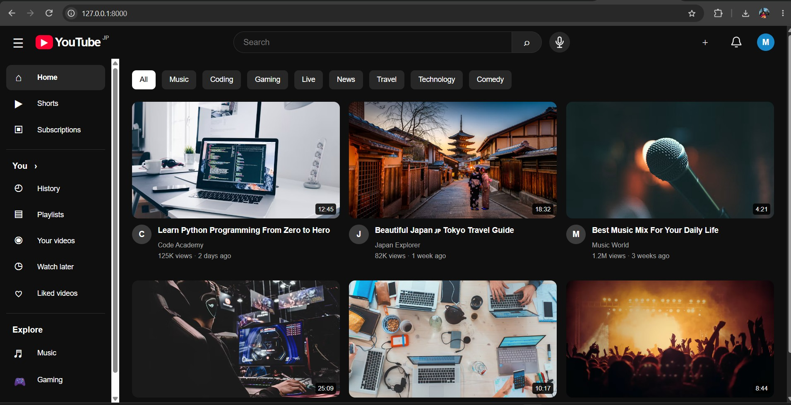

# YouTube Clone — Django

A YouTube-inspired video-sharing web application built with Django, HTML, CSS, and JavaScript. This project is part of my journey toward becoming a Backend Engineer, focusing on web application development and Django fundamentals.

Djangoを使用して、YouTubeを参考にした動画共有Webアプリケーションを開発する学習プロジェクトです。PythonとDjangoによるバックエンド開発の基礎を実践的に学んでいます。

## Screenshots

### Homepage



The homepage features a dark theme inspired by YouTube, including sidebar navigation, a search bar, category filters, microphone and notification icons, and a video thumbnail grid.

## Features

- YouTube-inspired dark homepage UI
- Sidebar navigation with Home, Shorts, Subscriptions, and History
- Video thumbnail grid with titles, channel names, and view information
- Search interface for filtering displayed videos
- Category-based video filtering
- Microphone button with browser-supported voice search
- Responsive layout for desktop and mobile screens
- Django-based project structure
- Environment variable configuration using `.env`

*Note: This is a learning project. Features such as user authentication, video uploads, and database-driven video management may require further development.*

## Tech Stack

- **Language:** Python, HTML, CSS, JavaScript
- **Framework:** Django
- **Database:** SQLite (development)
- **Frontend:** HTML5, CSS3, JavaScript
- **Tools:** Git, GitHub, VS Code
- **Configuration:** Environment variables using `.env`

## Project Structure

```text
Youtube_Clone/
├── config/
│   ├── settings.py
│   ├── urls.py
│   └── wsgi.py
├── home/
├── main/
├── shorts/
├── templates/
├── static/
├── screenshots/
│   └── youtube_homepage.jpg
├── manage.py
├── requirements.txt
├── .env.example
├── .gitignore
└── README.md
```

*The structure above is illustrative. Update it to match your actual project files.*

## Getting Started

### 1. Clone the repository

```bash
git clone https://github.com/lipumehedi/Youtube_Clone.git
cd Youtube_Clone
```

### 2. Create a virtual environment

```bash
python -m venv venv
```

Activate the environment in Windows Git Bash:

```bash
source venv/Scripts/activate
```

### 3. Install dependencies

```bash
pip install -r requirements.txt
```

### 4. Configure environment variables

Create a `.env` file in the project root using the variables required by your Django settings.

Example `.env.example`:

```env
SECRET_KEY=replace-with-your-own-secret-key
DEBUG=True
ALLOWED_HOSTS=127.0.0.1,localhost
```

Make sure your settings are configured to read these variables and keep your actual `.env` file out of Git.

### 5. Run database migrations

```bash
python manage.py migrate
```

### 6. Start the development server

```bash
python manage.py runserver
```

Open the following URL in your browser:

http://127.0.0.1:8000/

## Security

- Keep `.env` and private secret keys out of version control.
- Use `.env.example` to document required environment variables.
- Do not commit virtual environments or local database files.

## Learning Goals

- Understand Django project and app structure.
- Practice URL routing, views, and templates.
- Learn database models and Django ORM.
- Improve frontend integration with Django.
- Practice Git and GitHub version control.
- Build practical projects for a Backend Engineer portfolio.

## About Me

I am an aspiring Backend Engineer based in Japan, learning Python, Django, SQL, PostgreSQL, and Git/GitHub.

I am interested in building practical web applications and improving my backend development skills through hands-on projects.

- **GitHub:** [lipumehedi](https://github.com/lipumehedi)

## Disclaimer

This is an independent educational project inspired by YouTube's interface. It is not affiliated with or endorsed by YouTube or Google.